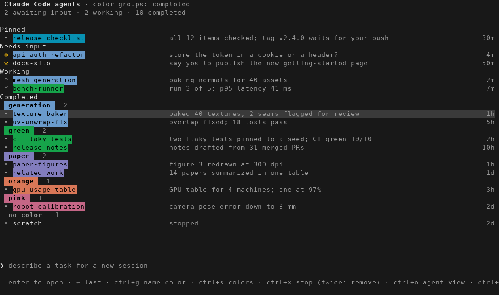

# color-groups

`claude-groups` is a terminal panel in place of Claude Code's agent view (`claude agents`),
drawn the way the agent view draws: Pinned, Needs input, Working and Completed, each
session's name as a chip in its `/color`, and **Completed grouped by color**, each color
renamable to a project name. Enter opens a session; **← in that session comes back here**.



## Run

Link it once as `cgs` into a folder on your `PATH` (`~/.local/bin` holds Claude Code's own
launcher), then type `cgs` in any terminal:

```bash
ln -s "$PWD/plugins/color-groups/claude-groups" ~/.local/bin/cgs   # from the repository root
cgs                                                                # or: cgs <session id> to focus it first
```

| Key | Does |
| --- | --- |
| ↑ ↓, PgUp PgDn, Home End | move |
| Enter | open the focused session (`claude attach`) |
| type, then Enter | start a new background session with that task (`claude --bg`), as the agent view's prompt does |
| ← in a session | come back here, the session focused |
| ← here | open the last session again |
| Ctrl+G | name the focused session's color (empty: its color name back) |
| Ctrl+S | where colors group: Completed → every section → off |
| Ctrl+X | as in the agent view: stop the focused session if it is running (`claude stop`); a second Ctrl+X within 2 s removes it from the list (`claude rm`: its worktree is deleted only when that is safe, its conversation stays in `claude --resume`) |
| Ctrl+O | the built-in agent view |
| Esc | clear the prompt; Ctrl+C quits |
| Mouse | as in the agent view: hover focuses a session, a click opens it, a click on a heading folds or unfolds it, the wheel moves |

Names are kept in `~/.config/claude-groups.json`. A session changes only when you stop it.

## Colors

Claude Code 2.1.319's own agent colors (its `<color>_FOR_SUBAGENTS_ONLY` theme keys, the same
in its dark and light themes), drawn as Claude draws them: black text on the color.

| red | blue | green | yellow | purple | orange | pink | cyan |
| --- | --- | --- | --- | --- | --- | --- | --- |
| 220,38,38 | 106,155,204 | 22,163,74 | 202,138,4 | 130,125,189 | 217,119,87 | 196,102,134 | 8,145,178 |

Details and ages are the dark theme's `inactive` gray (153,153,153), a session that needs
input has the `warning` ✻ (255,193,7), and the focused row the agent view's gray background.
With `COLORTERM=truecolor` the colors are exact; otherwise each is the 256-color code chalk
gives it, the code Claude Code itself draws then (checked against a capture of `claude agents`).

## How ← comes back here

On ←, `claude attach` relaunches itself as `~/.local/bin/claude agents` (the same process,
with `CLAUDE_AGENTS_SELECT` set; measured with `strace` on Claude Code 2.1.319). The panel
starts each session as its own child, watches that child's `/proc/<pid>/cmdline`, and stops
it the moment it turns into `claude agents`, then draws itself again. So ← comes here for
sessions opened from this panel; a session opened from the built-in agent view still goes
back there.

Claude Code's own agent view cannot do this: its custom groups (`agents:setGroup`, group
mode `group`) are compiled off in 2.1.319, its grouping is by state or directory only, and
a mod (plugin hooks) cannot draw in it or switch sessions.

## Test

```bash
python3 -m unittest plugins/color-groups/test_claude_groups.py
```
